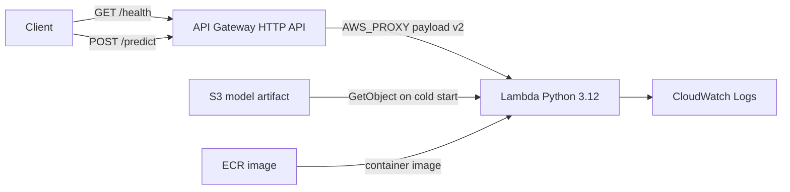
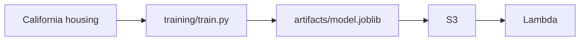

# Serverless California housing prediction API

[](https://github.com/Devam360/serverless-ml-inference-aws/actions/workflows/ci.yml)

A small regression service for a data-science portfolio. A reproducible script trains a scikit-learn pipeline on the public California housing data set, and an AWS Lambda function scores one census block group per request. API Gateway exposes `GET /health` and `POST /predict`. The fitted pipeline lives in a private S3 bucket and is loaded on cold start. Terraform builds the stack. GitHub Actions lints and tests every push, and a separate workflow deploys with OIDC instead of long-lived AWS keys.

## Resume bullet

Built a serverless regression API for California census-block median house values. Trained a scikit-learn `Pipeline` (`StandardScaler` and `HistGradientBoostingRegressor`) on the 20,640-row California housing data set (80/20 split, `random_state` 42) with holdout RMSE 0.441803 and R² 0.851047, against a median-baseline RMSE of 1.173117. Served predictions from a Python 3.12 Lambda container behind an HTTP API, loading the joblib artifact from a private S3 bucket at cold start, with a least-privilege execution role, Terraform, pytest, and GitHub Actions CI plus an OIDC deploy workflow.

## Key results

These figures come from one run of `training/train.py` on 2026-10-30. The full record, including versions and the example row, is `artifacts/metrics.json` (`trained_at` `2026-10-30T16:55:05+00:00`, Python 3.12.3, scikit-learn 1.9.1, NumPy 2.5.4). A unit test fails if this section drops the measured strings.

The loader returns 20640 block groups and 8 numeric features. `train_test_split` holds out 20% with `random_state=42`: 16512 train rows and 4128 test rows. The model is `Pipeline(StandardScaler, HistGradientBoostingRegressor)` with `loss=squared_error`, `learning_rate=0.08`, `max_iter=300`, `max_depth=8`, `min_samples_leaf=20`, `l2_regularization=0.1`, `early_stopping=false`, and `random_state=42`. The baseline is `DummyRegressor(strategy="median")` fit on the same training rows. The artifact on disk is 475,521 bytes.

RMSE and MAE are in the target's units: median house value, in $100,000s from the 1990 census. Multiply by 100,000 to read them as 1990 dollars.

| Model | Split | RMSE | MAE | R² |
| --- | --- | ---: | ---: | ---: |
| StandardScaler + HistGradientBoostingRegressor | train | 0.331916 | 0.228981 | 0.917587 |
| StandardScaler + HistGradientBoostingRegressor | test | 0.441803 | 0.291630 | 0.851047 |
| Median baseline | test | 1.173117 | 0.874040 | -0.050209 |

Holdout RMSE 0.441803 is $44,180.30 in 1990 dollars. Holdout MAE 0.291630 is $29,163.00. The median baseline's test RMSE of 1.173117 is $117,311.70. The fractional RMSE reduction versus that baseline, `1 - model_rmse / baseline_rmse`, is **0.623394**. The baseline R² is negative because `r2_score` compares predictions with the test-set mean, and a median predictor sits slightly off that mean.

The published target is censored. In this run the observed target runs from 0.14999 to 5.00001, and **992** rows sit on the maximum (about $500,001).

Permutation importance on the holdout set (5 repeats, scoring `neg_root_mean_squared_error`) ranks features by how much RMSE rises when that column is shuffled. The largest holdout permutation importance is Latitude.

| Feature | Mean RMSE increase | Std. across 5 shuffles |
| --- | ---: | ---: |
| Latitude | 0.814794 | 0.011882 |
| Longitude | 0.730236 | 0.009013 |
| MedInc | 0.401403 | 0.006999 |
| AveOccup | 0.182847 | 0.005424 |
| AveRooms | 0.101344 | 0.002646 |
| HouseAge | 0.062725 | 0.003643 |
| AveBedrms | 0.012865 | 0.000935 |
| Population | 0.011192 | 0.000682 |

Latitude and longitude are spatially correlated, so those two increases are not additive shares of importance. MedInc is the strongest feature that is not a coordinate. Population and average bedrooms are near zero on this split once the other columns are present.

The demo request below is test-set row 0, scored after rounding each feature to 6 decimal places (the values in `examples/predict.json`). Actual value 0.4770 ($47,700). Prediction 0.5986 ($59,860). The residual on this one block group is 0.1216 ($12,160), inside the holdout MAE.

## Architecture





Training is offline. The container image carries the Python dependencies. Terraform uploads `artifacts/model.joblib` to S3, and the function downloads that object the first time an execution environment handles a request, then keeps it in memory. Replacing the object and updating the function picks up a new fit without baking weights into the image.

The function runs outside a VPC. Nothing in the request path needs a private subnet, so the stack has no NAT gateway. API Gateway throttles the stage to 10 requests per second with a burst of 20. CloudWatch keeps the function's logs for 14 days. The execution role may create log streams in that log group and call `s3:GetObject` on the single model key.

GitHub Actions CI runs Ruff, pytest, `terraform fmt -check`, and `terraform validate` with `-backend=false`. The deploy workflow is `workflow_dispatch` only. It assumes an IAM role through GitHub's OIDC provider, pushes an image to ECR, and runs `terraform apply`.

## Repository layout

```text
training/train.py            reproducible fit; writes artifacts/ and examples/
src/housing_api/             validation, model loading, Lambda handler, local server
artifacts/model.joblib       pipeline plus metrics (loaded by tests and the API)
artifacts/metrics.json       the numbers in Key results
examples/predict.json        holdout features for the curl below
infra/                       Lambda, HTTP API, S3, IAM, logs, ECR, optional OIDC role
.github/workflows/ci.yml     lint, unit tests, terraform validate
.github/workflows/deploy.yml manual OIDC deploy
```

## API contract

`POST /predict` takes a JSON object. Names match `sklearn.datasets.fetch_california_housing`. The handler checks types and bounds, then lays the columns out in that order for the pipeline. Extra keys are rejected so a typo does not silently drop a feature. Values are JSON numbers. Strings are rejected.

| Field | Meaning | Accepted range |
| --- | --- | --- |
| MedInc | Median income in the block group, in tens of thousands of USD | 0 to 20 |
| HouseAge | Median house age in years | 1 to 60 |
| AveRooms | Average rooms per household | 0.5 to 50 |
| AveBedrms | Average bedrooms per household | 0.2 to 15 |
| Population | Block group population | 1 to 40000 |
| AveOccup | Average household members | 0.5 to 20 |
| Latitude | Block group latitude | 32 to 42.5 |
| Longitude | Block group longitude | -125 to -114 |

Of the 20640 source rows, 20621 fall inside these bounds. The other 19 are extreme block groups with very large average rooms, bedrooms, or household size, and the API refuses them.

`GET /health` loads the artifact and returns the model version plus the holdout RMSE, MAE, and R² stored inside it.

The response `prediction` uses the same units as training. A value of 2.5 means a median house value of $250,000 in 1990 census dollars.

## Local setup

Requires Python 3.12.

```bash
python3 -m venv .venv
source .venv/bin/activate
pip install -e ".[dev]"
```

The committed artifact is enough to run the API and the tests. To refit:

```bash
python training/train.py
```

The script downloads the California housing file through scikit-learn (about 400 KB, cached under `~/scikit_learn_data`) and overwrites `artifacts/model.joblib`, `artifacts/metrics.json`, `examples/predict.json`, and `examples/apigw_event.json`. After a refit, update the Key results section so it still quotes `artifacts/metrics.json`. `tests/test_contract.py` checks that the measured strings are still in this file.

Run the unit tests and the linters:

```bash
pytest
ruff check .
ruff format --check .
```

Or, with the virtualenv's interpreter: `make test PYTHON=.venv/bin/python` and `make lint PYTHON=.venv/bin/python`.

## Demo without AWS

Start the stdlib server. It calls the same handler the Lambda function uses, with an API Gateway HTTP API v2 event.

```bash
MODEL_PATH=artifacts/model.joblib python -m housing_api.local_server
```

The process listens on `http://127.0.0.1:8080` (`HOST` and `PORT` override that).

Health:

```bash
curl -sS http://127.0.0.1:8080/health
```

```json
{
  "status": "ok",
  "model_loaded": true,
  "model_version": "california-housing-hgb-v1",
  "test_metrics": {
    "rmse": 0.441803,
    "mae": 0.29163,
    "r2": 0.851047
  }
}
```

`mae` is `0.29163` in the JSON body because the stored float has a trailing zero. The table above prints it as 0.291630.

Predict, using the holdout row in `examples/predict.json`:

```bash
curl -sS -X POST http://127.0.0.1:8080/predict \
  -H 'content-type: application/json' \
  -d @examples/predict.json
```

```json
{
  "prediction": 0.5986,
  "units": "100,000 USD (1990 census median house value)",
  "model_version": "california-housing-hgb-v1"
}
```

A latitude outside California:

```bash
curl -sS -X POST http://127.0.0.1:8080/predict \
  -H 'content-type: application/json' \
  -d '{"MedInc":3.5,"HouseAge":20,"AveRooms":5,"AveBedrms":1,"Population":1000,"AveOccup":3,"Latitude":10,"Longitude":-122}'
```

```json
{
  "error": "Invalid input.",
  "details": [
    "'Latitude' must be between 32 and 42.5."
  ]
}
```

The same handler accepts a bare feature object, which is convenient in the Lambda console. `examples/apigw_event.json` is a payload-v2 event whose body is that holdout row.

A container demo uses the Lambda runtime interface on port 9000. The model is mounted in; the image does not contain it.

```bash
docker build -t housing-predictor .
docker run --rm -p 9000:8080 \
  -e MODEL_PATH=/var/task/model.joblib \
  -v "$PWD/artifacts/model.joblib:/var/task/model.joblib:ro" \
  housing-predictor
curl -sS -X POST "http://127.0.0.1:9000/2015-03-31/functions/function/invocations" \
  -d @examples/apigw_event.json
```

## Infrastructure

`infra/` is the stack:

- ECR repository and a lifecycle policy that keeps the five newest images
- Lambda function, package type `Image`, 1024 MB, 30 second timeout, x86_64
- S3 bucket with a generated name (`housing-predictor-model-…`), public access blocked, versioning, SSE-S3, TLS-only bucket policy, and expiration of noncurrent versions after 30 days
- The model object at `models/california-housing/model.joblib`
- HTTP API with `GET /health` and `POST /predict`, payload format 2.0, CORS for `GET` and `POST`, stage throttle 10 rps / burst 20
- Two Lambda permissions, one per route
- CloudWatch log group `/aws/lambda/housing-predictor-predict` with 14-day retention
- Execution role that can write streams in that log group and `s3:GetObject` the model key
- Optional GitHub OIDC provider and deploy role (`create_github_oidc_provider` and `create_github_oidc_role`, default `false` so `terraform validate` needs no AWS account)

`lambda_image_uri` defaults to a `000000000000` placeholder so validate succeeds before any image exists. Apply rejects that placeholder.

Useful outputs: `api_base_url`, `health_url`, `predict_url`, `model_bucket_name`, `ecr_repository_url`, `lambda_function_name`, `github_deploy_role_arn`.

Check the configuration locally (Terraform 1.5 or newer; CI uses 1.9.8):

```bash
terraform -chdir=infra fmt -check -recursive
terraform -chdir=infra init -backend=false -input=false
terraform -chdir=infra validate
```

## Deploy

No static AWS keys are required in GitHub. The workflow assumes a role with `sts:AssumeRoleWithWebIdentity`. Trust is limited to `repo:Devam360/serverless-ml-inference-aws:ref:refs/heads/main` unless you set `github_oidc_subject`.

### GitHub configuration

| Name | Kind | Required | Purpose |
| --- | --- | --- | --- |
| `AWS_ROLE_ARN` | secret | yes | Role ARN from output `github_deploy_role_arn` |
| `TF_STATE_BUCKET` | secret | yes | Pre-created S3 bucket for Terraform state |
| `TF_LOCK_TABLE` | secret | no | DynamoDB lock table name. Hash key `LockID` (string). |
| `AWS_REGION` | variable | no | Defaults to `us-east-1` |
| `TF_STATE_KEY` | variable | no | Defaults to `housing-predictor/terraform.tfstate` |

The state bucket should have versioning and default encryption. Create it, and the lock table if you want one, before the first `terraform init`. They are outside this stack so the role can be created without a circular dependency on the state bucket.

### One-time bootstrap

Use an admin principal on your laptop for this part. The deploy role cannot create itself.

```bash
export AWS_REGION=us-east-1
export TF_STATE_BUCKET=your-terraform-state-bucket
export ACCOUNT_ID="$(aws sts get-caller-identity --query Account --output text)"

terraform -chdir=infra init \
  -backend-config="bucket=${TF_STATE_BUCKET}" \
  -backend-config="key=housing-predictor/terraform.tfstate" \
  -backend-config="region=${AWS_REGION}" \
  -backend-config="encrypt=true"
# add -backend-config="dynamodb_table=your-terraform-locks" if you created one

# Repository first, so the image has somewhere to land.
terraform -chdir=infra apply \
  -target=aws_ecr_repository.lambda \
  -target=aws_ecr_lifecycle_policy.lambda \
  -var="aws_region=${AWS_REGION}"

REPO="$(terraform -chdir=infra output -raw ecr_repository_url)"
aws ecr get-login-password --region "$AWS_REGION" \
  | docker login --username AWS --password-stdin "${REPO%%/*}"
docker build --platform linux/amd64 --provenance=false -t "${REPO}:bootstrap" .
docker push "${REPO}:bootstrap"

terraform -chdir=infra apply \
  -var="aws_region=${AWS_REGION}" \
  -var="lambda_image_uri=${REPO}:bootstrap" \
  -var="create_github_oidc_provider=true" \
  -var="create_github_oidc_role=true" \
  -var="terraform_state_bucket_arn=arn:aws:s3:::${TF_STATE_BUCKET}"
# add -var="terraform_lock_table_arn=arn:aws:dynamodb:${AWS_REGION}:${ACCOUNT_ID}:table/your-terraform-locks"
# when you use a lock table

terraform -chdir=infra output -raw github_deploy_role_arn
```

Put that ARN in the `AWS_ROLE_ARN` secret. Later applies, including `.github/workflows/deploy.yml`, must keep `create_github_oidc_provider` and `create_github_oidc_role` set to `true` and must pass the same state-bucket ARN. An apply that flips those flags back to the default removes the role.

In the GitHub repository settings, add an Actions OIDC trust if you created the provider above (the bootstrap apply does that). Then run the **Deploy** workflow on `main` via "Run workflow". It builds `linux/amd64` with provenance attestations turned off (Lambda accepts a plain image), pushes the commit SHA as the tag, applies the stack, and curls `/health` and `/predict`.

The deploy role is scoped to this project's names: the prediction function, the `housing-predictor-model-*` buckets, the ECR repository, the function log group, HTTP APIs in the region, and the Lambda execution role. It can read its own role and refresh the GitHub OIDC thumbprint. It cannot attach policies to itself or change its trust policy. `ecr:GetAuthorizationToken` and `logs:DescribeLogGroups` are granted on `*` because those APIs do not support a resource ARN. State-bucket and lock-table access is added only when the ARNs are passed in. If a later apply reports `AccessDenied`, the missing action is the one to add in `infra/github_oidc.tf`.

`infra/backend.hcl.example` and `infra/terraform.tfvars.example` match the flags above. Copy them rather than committing a filled-in `*.tfvars` (those files are gitignored).

## Cost

List prices below are the public rates this write-up used (us-east-1 class). Check the AWS pricing pages before quoting them. This repository has no measured AWS bill.

- Lambda (x86): $0.20 per million requests and $0.0000166667 per GB-second. Every month includes 1 million requests and 400,000 GB-seconds.
- API Gateway HTTP APIs: $1.00 per million requests. New accounts also get a 12-month free tier of 1 million HTTP API calls.
- S3 Standard storage is about $0.023 per GB-month. This artifact is 475,521 bytes, so object storage is a fraction of a cent. Requests are $0.0004 per 1,000 GETs.
- CloudWatch Logs ingestion is $0.50 per GB. Retention is 14 days.
- ECR storage is $0.10 per GB-month. The lifecycle policy keeps five images. The scikit-learn base image is the line most likely to show a small monthly charge; read the repository size after the first push.
- The function is not in a VPC, so there is no NAT gateway. A NAT gateway's hourly charge is about $0.045 in many regions and would dominate this demo.

Illustrative arithmetic, not a measurement: 10,000 requests in a month, 1024 MB, and an assumed 200 ms average billed duration is 2,000 GB-seconds. That sits inside the Lambda free tier. API Gateway at $1 per million requests is $0.01 for those 10,000 calls.

The stage throttle (10 requests per second, burst 20) is what keeps a public unauthenticated URL from running away. Destroy the stack with `terraform destroy` when you are done, and the ECR lifecycle policy will not by itself delete the repository on an idle account until you destroy it.

## Limitations

- The target is 1990 census dollars for a block group, not a current price for a single house.
- 992 training rows are censored at about $500,001, so the model cannot rank values above that cap.
- The endpoint is unauthenticated. The throttle is the cost control. Add a JWT authorizer or IAM auth before putting real clients on it.
- The artifact is a joblib pickle. The bucket is private, public access is blocked, and only the deploy path should write the object. Do not point `MODEL_PATH` or `MODEL_BUCKET` at a file you did not train.
- API Gateway's HTTP API integration timeout is 30 seconds. The Lambda timeout is set to that same ceiling. Raising memory is the lever if a cold start gets close to it.
- API bounds drop 19 extreme rows from the source table. They are a product check, not part of the fitted pipeline.

## Data

Pace, R. Kelley, and Ronald Barry. "Sparse Spatial Autoregressions." *Statistics and Probability Letters* 33.3 (1997): 291–297. Distributed with scikit-learn as `sklearn.datasets.fetch_california_housing`.
